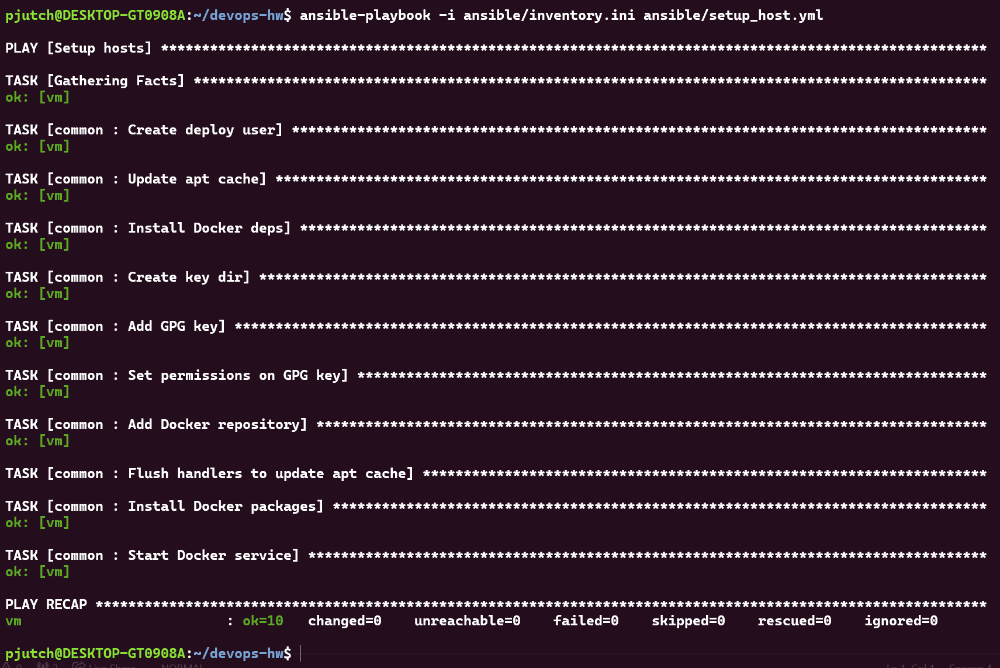
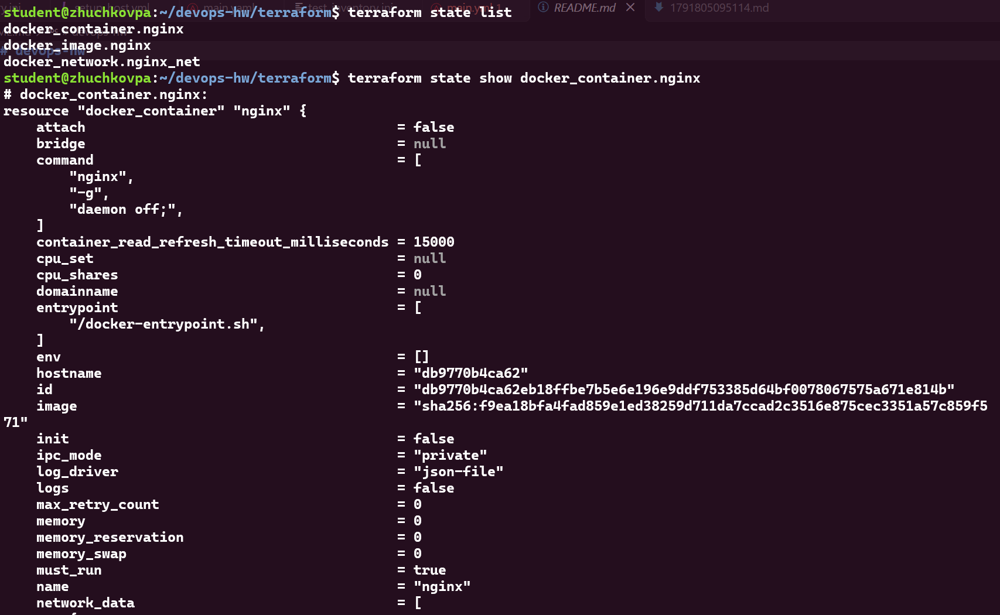
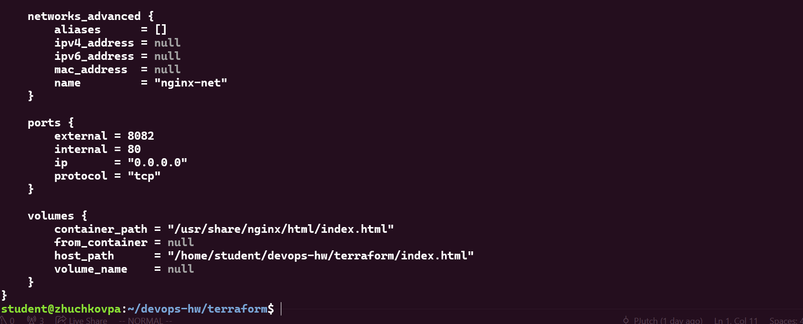
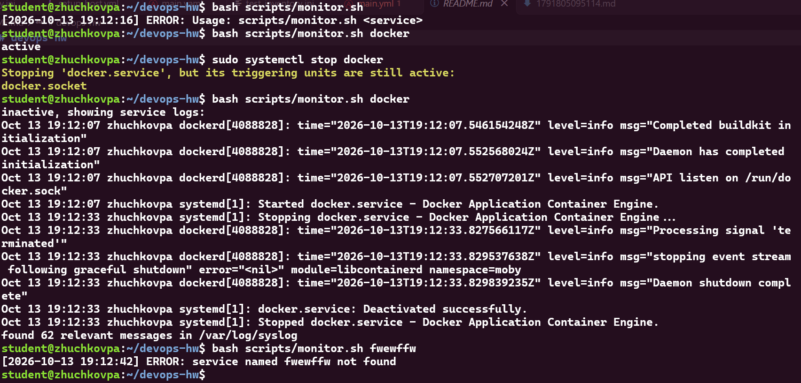
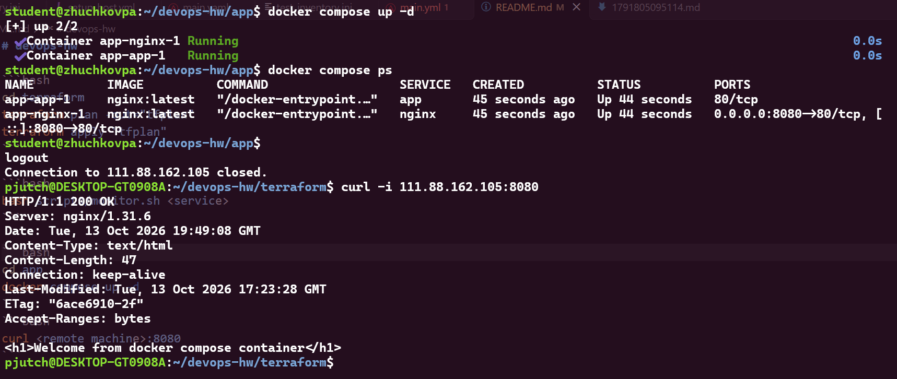

# DevOps. Домашнее задание №1

## Ansible
На локальной машине
```
ansible-playbook -i ansible/inventory.ini ansible/setup_host.yml
```


## Terraform
На удалённой машине
```bash
cd terraform
terraform plan -out="tfplan"
terraform apply "tfplan"
```



## Bash
На удалённой машине
```bash
bash scripts/monitor.sh <service>
```


## Docker Compose
На удалённой машине
```bash
cd app
docker compose up -d
```
```bash
curl <remote machine>:8080
```
На локальной машине

